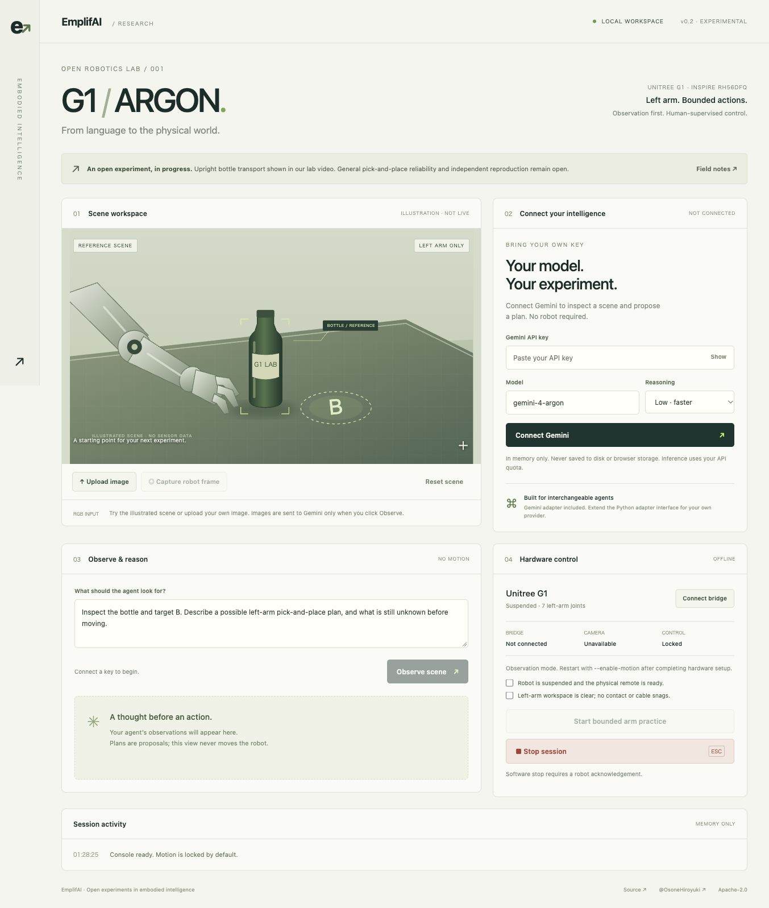
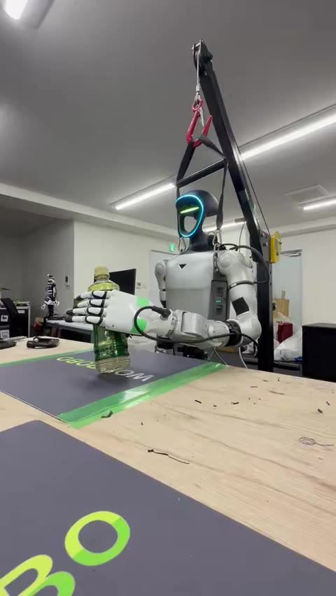
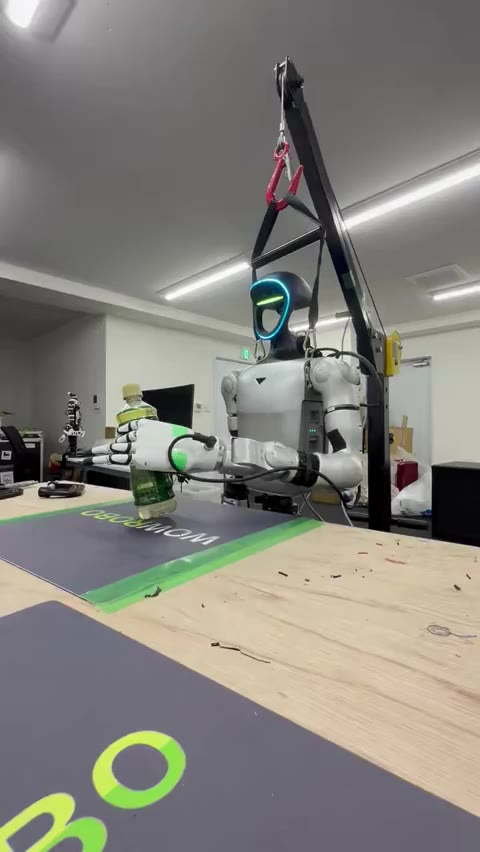
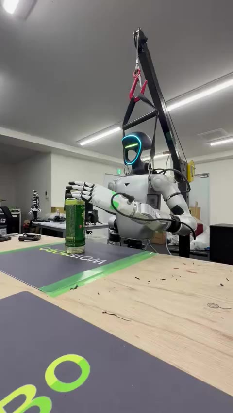
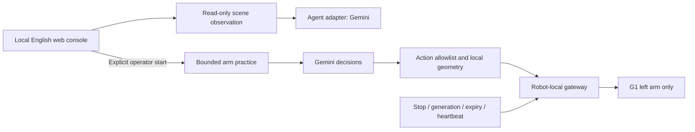

<div align="center">

# G1 / ARGON

### An open experiment in language-guided humanoid control.

**A real Unitree G1. A bottle carried upright. A local console you can try with your own API key.**

[](LICENSE)
[](https://github.com/EmplifAI/g1-argon-pick-place/actions/workflows/ci.yml)
[EmplifAI](https://emplif.ai/) · [Hardware video](https://x.com/OsoneHiroyuki/status/2110614582570164644) · [@OsoneHiroyuki](https://x.com/OsoneHiroyuki) · [Contribute](CONTRIBUTING.md)

</div>



**Start with observation.** Launch the English web app, enter a Gemini API key,
and ask the agent to inspect an image. No robot SDK, Node build, account with us,
or cloud deployment is needed. Your key stays in local process memory.

**Go deeper with hardware.** The research code connects Gemini Argon to a suspended
Unitree G1 and a left RH56DFQ Inspire Hand. The public console offers bounded
left-arm practice after explicit hardware setup. The older full manipulation
macro remains experimental source, not a one-click public control mode.

## See the real experiment

[**▶ Watch Hiroyuki Osone's full hardware video on X**](https://x.com/OsoneHiroyuki/status/2110614582570164644)

| 01:00 — bottle lifted | 01:30 — bottle at the table | 02:00 — hand withdrawn |
| --- | --- | --- |
|  |  |  |

These are **real frames extracted from the linked public video**, not generated
images or simulated telemetry. The video documents a lab demonstration of upright
bottle transport. It does not establish a success rate, autonomous recovery,
or reproducibility on another robot. The exact demo configuration has not been
revalidated against this release. [Sample provenance and evidence](docs/SAMPLES.md).

## Try it in one command

Python **3.9+** and a modern browser are enough for the observation console.
Python 3.12 is recommended for the optional robotics dependencies.

```sh
git clone https://github.com/EmplifAI/g1-argon-pick-place.git
cd g1-argon-pick-place
python3 scripts/start_web.py
```

The app opens at **http://127.0.0.1:8780**.

1. Paste your Gemini API key and click **Connect Gemini**.
2. Use the clearly labeled illustration, upload a JPEG/PNG/WebP, or upload one of
   the real sample frames in `docs/assets/`.
3. Click **Observe scene**. Read observations, uncertainties and a proposed plan.
4. **Disconnect & clear key** removes the stored key from the session.

Observation never sends robot commands. A key with access to the selected model
and available inference quota is required; a successful key check does not prove
that billing or inference quota is available. The default is `gemini-4-argon`
with low reasoning. Select medium/high or edit the model ID in the UI.
The adapter uses Google's [Interactions API](https://ai.google.dev/gemini-api/docs/latest-model).

```sh
# Choose another port, or launch without opening a browser
python3 scripts/start_web.py --port 8781 --no-browser
```

## What works, and what remains open

| Area | Current evidence / scope |
| --- | --- |
| English BYOK web app | Local image observation, configurable model/reasoning, error handling, memory-only key storage |
| Physical demo | Public video of upright bottle transport on a suspended G1; earlier notes also record small arm motion and hand opening |
| Public motion mode | Explicitly enabled, maximum three small left-arm trials; no hand operations |
| Stop / watchdog | Local cancellation plus robot stop request; gateway generation, expiry and heartbeat checks; requires real hardware validation |
| Cartesian grasp / placement | Research implementation exists; gated primitives require fresh RGB-D and empirical calibration |
| General reliability | No published success-rate benchmark or independent reproduction |
| Other providers | Small adapter interface and Gemini implementation; Claude/OpenAI integrations are contribution opportunities |
| Data release | Public video frames and provenance; no synchronized joint/RGB-D dataset or raw private logs included |

The original Japanese [lab notes](docs/status.md) are historical. Their earlier
“not yet successful” status predates the later public video; neither is a claim
that the new console reproduces the full demo automatically.

## Connect a real G1

Read [hardware setup](docs/SETUP.md) before enabling motion. A key alone cannot
replace the robot, SDK, network, calibration and operator setup.

```sh
# After completing hardware setup, inside the robotics Python environment:
python scripts/start_web.py --enable-motion \
  --robot-url http://192.168.123.164:8767 \
  --camera-url http://127.0.0.1:8765
```

Click **Connect bridge** for a read-only handshake. Check the camera and robot
state, confirm suspension and workspace clearance, then start bounded practice.
**Stop session / Escape** cancels pending decisions and requests a robot-local
hold. Read the acknowledgement; use the physical remote if it fails.
Closing the browser does not stop the controller. Ctrl+C in the server terminal
stops its owned controller and requests a robot stop.

This is research software for a supervised, suspended robot. It is not a certified
safety system, a walking controller, or a general-purpose autonomous manipulation
product. Do not expose the console or robot bridge to the public Internet.

## Architecture



The LLM proposes actions; local code determines whether they are executable.
High-frequency joint interpolation stays on the robot, independent of model
latency. Right arm, right hand, waist and leg movement targets are outside scope.
The original left hand excludes pinky/ring channels 0 and 1; do not assume this
hardware-specific configuration matches your robot.

[Adapter guide](docs/ADAPTERS.md) · [Control internals](docs/control.md) ·
[Security boundaries](SECURITY.md) · [Launch copy](docs/LAUNCH.md)

## Develop and contribute

```sh
# Standard-library web/API checks; no paid requests or robot connection
python3 -m unittest discover -s tests -p 'test_web*.py' -v
python3 -m compileall -q src scripts
```

Full offline robotics tests additionally need the pinned robot description,
Pinocchio and Unitree SDK2; see [setup](docs/SETUP.md).

We welcome calibration tools, recorded-scene evaluations, alternative agent
adapters, failure reports and installation improvements. Report what you actually
measured and distinguish hardware from mocks. Sign commits with `git commit -s`
under the [DCO contribution policy](CONTRIBUTING.md).

If you build on this, cite [CITATION.cff](CITATION.cff) and link your reproduction.
For integration support, custom tasks or joint evaluations, [talk to EmplifAI](https://emplif.ai/contact).

## License and credits

Copyright 2026 **EmplifAI**. Original code and documentation are licensed under
[Apache-2.0](LICENSE), including commercial use subject to its terms.
[NOTICE](NOTICE) and [third-party notices](THIRD_PARTY_NOTICES.md) describe scope
and provenance. External SDKs, robot assets and API services retain their own terms.

Created by [Hiroyuki Osone / @OsoneHiroyuki](https://x.com/OsoneHiroyuki) and EmplifAI.
Unitree, G1, Inspire, Gemini and Argon identify the respective hardware/services;
this independent project is not endorsed by their owners. No trademark rights
are granted.
